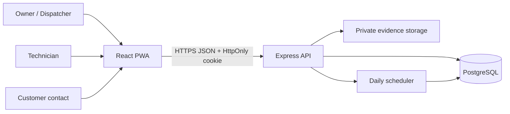
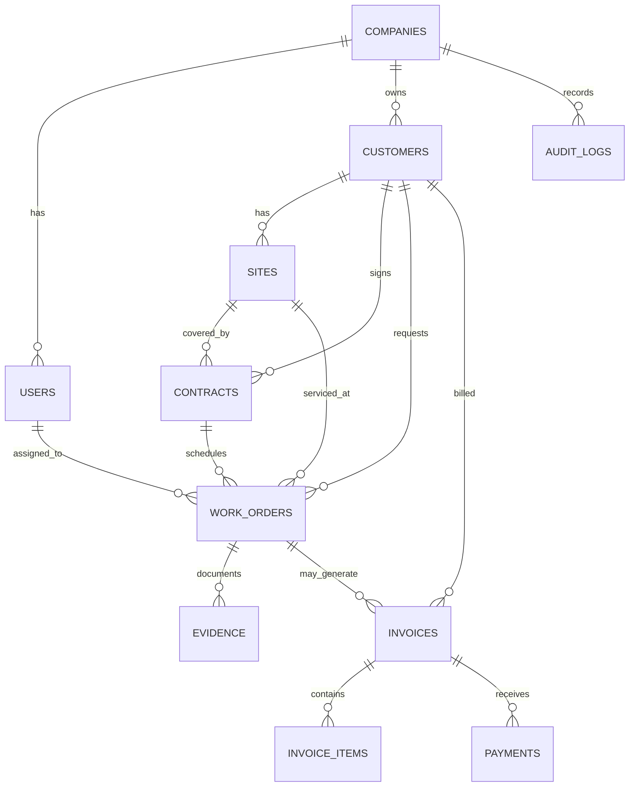
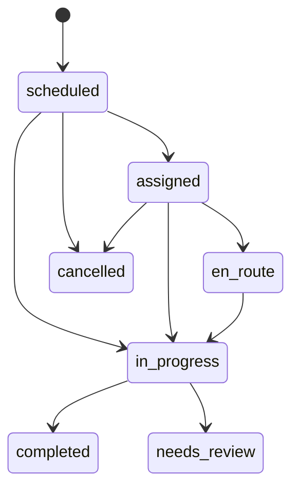

# ServiProof architecture

## System context

ServiProof is a multi-tenant field-service platform. The initial market is small and midsize commercial pest-control operators that need to coordinate repeat visits, technicians, treatment evidence and billing.

The web application is a separately deployable static frontend. The API is the trust boundary: the browser never supplies a company ID to select tenant data. Every protected query derives `company_id` from the authenticated session.

## Tenant and identity model

- A `company` is a tenant/workspace.
- A `user` belongs to exactly one company in this release.
- An internal user has one of `owner`, `admin`, `dispatcher` or `technician` roles.
- A customer portal user has role `customer` and a `customer_id` that points to a customer record in the same company.
- Operational tables carry `company_id` and composite foreign keys that pair entity identifiers with the same company identifier.
- API list queries scope by `company_id`. Customer and technician routes add narrower filters.

This is a workspace model, not a cross-company account model. A user who needs to work in multiple companies currently needs a separate account in each workspace.

## Data model

### Main aggregates

| Aggregate | Important tables | Responsibility |
|---|---|---|
| Workspace and identity | `companies`, `users` | Tenant setup, account identity, roles |
| Customer management | `customers`, `sites` | Customer contacts and service locations |
| Service commitments | `contracts` | Contract terms and recurrence configuration |
| Field execution | `work_orders`, `evidence` | Dispatch, execution status and proof |
| Billing | `invoices`, `invoice_items`, `payments` | Amounts owed, received and reconciled |
| Accountability | `audit_logs` | Actor and event history |

## Work-order lifecycle

The initial API exposes `start` and `complete` actions and assignment. The schema permits additional states; a dedicated `en_route` action and review resolution endpoint are next workflow increments. The completion endpoint restricts technicians to their assigned work orders, while permitted workspace managers can perform supervised corrections.

## Recurrence engine

The scheduler runs at 00:10 in `Africa/Nairobi`. It selects active contracts where `next_service_date <= CURRENT_DATE` and a service site is defined. It locks each contract row, inserts the work order with a recurrence date, then advances the contract date. Month-end calculations clamp to the last valid day (31 January → 28/29 February) instead of overflowing into the following month.

A unique constraint on `(company_id, contract_id, recurrence_date)` protects against duplicate work orders if more than one scheduler tries to process the same contract. Row locking uses `FOR UPDATE SKIP LOCKED`.

The current scheduler handles one due occurrence per contract each run. A prolonged outage that leaves several intervals overdue will catch up one interval per daily run; a future enhancement should support bounded catch-up batches and notify an operator when many periods are missed.

## Authentication and authorisation

1. Registration creates a company and owner account in one transaction.
2. Login verifies a bcrypt password hash and issues a signed 12-hour JWT.
3. The JWT is stored only in an HttpOnly cookie. The browser does not receive the signing secret.
4. Auth middleware reloads the active user and company from PostgreSQL on each protected request.
5. Role middleware checks each protected operation.
6. Queries use the authenticated `company_id`; customer accounts are narrowed to their `customer_id`, and technicians are narrowed to their assignments.
7. Evidence downloads query the evidence row and work order permissions before sending the private file.

CORS is credential-enabled and uses the configured `WEB_ORIGIN` allow-list. Mutating requests with an Origin header outside that list are rejected. Production cookies require HTTPS and `COOKIE_SECURE=true`.

## API layers

- `server.ts`: HTTP middleware, CORS, security headers, health route, route mounting and shutdown.
- `middleware/auth.ts`: session creation, validation and invalidation.
- `routes/auth.ts`: registration, sign-in, sign-out and current session.
- `routes/app.ts`: workspace operations and business rules.
- `routes/evidence.ts`: private file upload/list/download.
- `scheduler.ts`: overdue invoice updates and recurring contract generation.
- `services/recurrence.ts`: deterministic recurrence date calculation.
- `db.ts`: pooled PostgreSQL connections.
- `migrations/001_initial.sql`: relational schema, constraints and indexes.

## Frontend organisation

- `App.tsx`: authenticated shell, navigation, module selection and modal workflows.
- `lib/api.ts`: credentialed API client, date and money formatting.
- `lib/offlineQueue.ts`: per-user work-order completion queue.
- `main.tsx`: React entry point and production service-worker registration.
- `public/service-worker.js`: app-shell cache only; never caches `/api/` responses.

## Scaling path

1. Move uploads to private S3/R2 storage with short-lived signed URLs and malware scanning.
2. Extract recurrence and notification tasks into a durable worker backed by a queue.
3. Add transactional outbox events for email/WhatsApp and billing notifications.
4. Add tenant-level rate limits, usage metering and subscription lifecycle.
5. Add observability (structured request IDs, metrics, tracing, error reporting and audit retention).
6. Add a cross-company identity model only when customers demonstrate a need for it.
